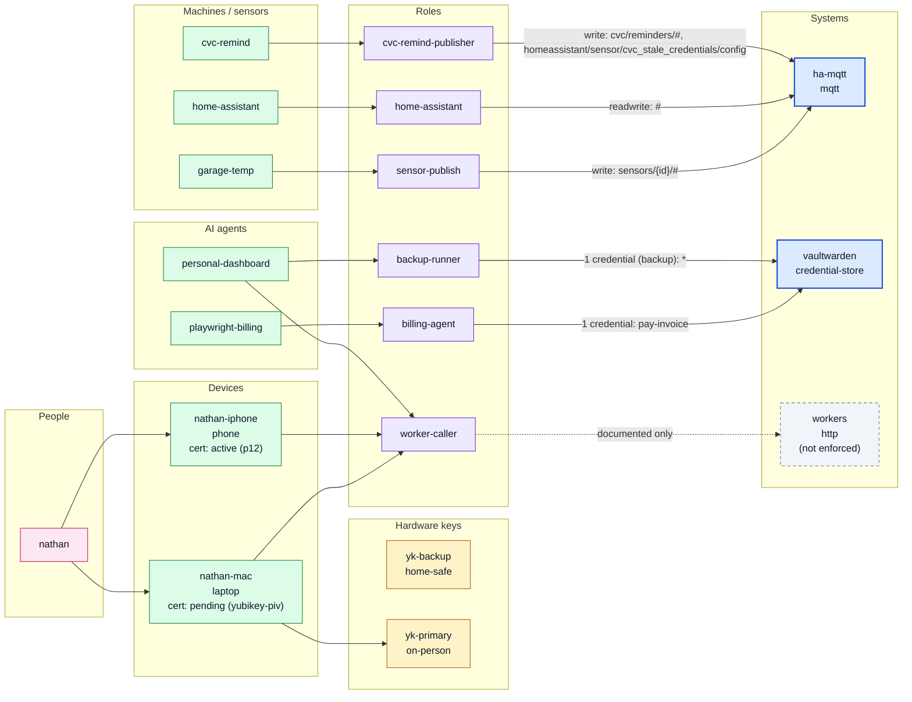

# Access graph

Generated 2026-10-31 by `cvc-access build graph` from the access registry.

Solid blue = enforced; dashed = documented only (not enforced); grey = expired; orange = expires within 30 days; yellow dashed = unused role. Revoked certs and lost/revoked/retired hardware keys are grey. Cert serials and fingerprints are never shown.

## Principals

| id | type | roles | expires | status |
|---|---|---|---|---|
| personal-dashboard | agent | backup-runner, worker-caller | 2027-01-31 | active |
| playwright-billing | agent | billing-agent | - | active |
| cvc-remind | machine | cvc-remind-publisher | - | active |
| garage-temp | machine | sensor-publish | - | active |
| home-assistant | machine | home-assistant | - | active |
| nathan-iphone | device | worker-caller | - | active |
| nathan-mac | device | worker-caller | - | active |

## Devices

| id | owner | kind | cert storage | cert status | cert not after | history entries |
|---|---|---|---|---|---|---|
| nathan-iphone | nathan | phone | p12 | active | 2027-01-31 | 1 |
| nathan-mac | nathan | laptop | yubikey-piv | pending | - | 0 |

## Hardware keys

| id | owner | model | uses | location | status | device certs |
|---|---|---|---|---|---|---|
| yk-backup | nathan | YubiKey 5 NFC | fido2-vaultwarden, recovery | home-safe | active | 0 |
| yk-primary | nathan | YubiKey 5C NFC | fido2-vaultwarden, piv-device-cert, recovery | on-person | active | 1 |

## Systems

| id | kind | enforced |
|---|---|---|
| ha-mqtt | mqtt | yes |
| vaultwarden | credential-store | yes |
| workers | http | no |
