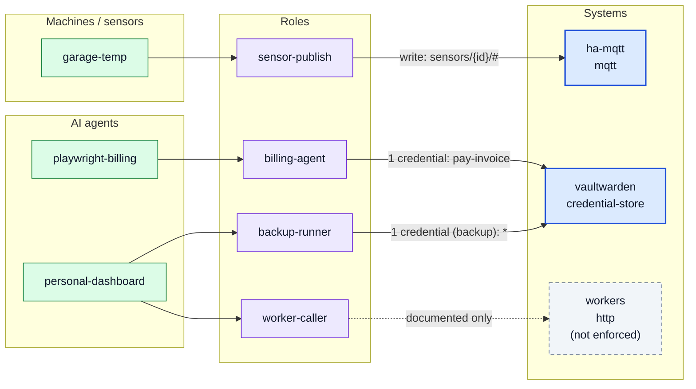

# Access graph

Generated 2026-10-31 by `cvc-access build graph` from the access registry.

Solid blue = enforced; dashed = documented only (not enforced); grey = expired; orange = expires within 30 days; yellow dashed = unused role.

## Principals

| id | type | roles | expires | status |
|---|---|---|---|---|
| personal-dashboard | agent | backup-runner, worker-caller | 2027-01-31 | active |
| playwright-billing | agent | billing-agent | - | active |
| garage-temp | machine | sensor-publish | - | active |

## Systems

| id | kind | enforced |
|---|---|---|
| ha-mqtt | mqtt | yes |
| vaultwarden | credential-store | yes |
| workers | http | no |
