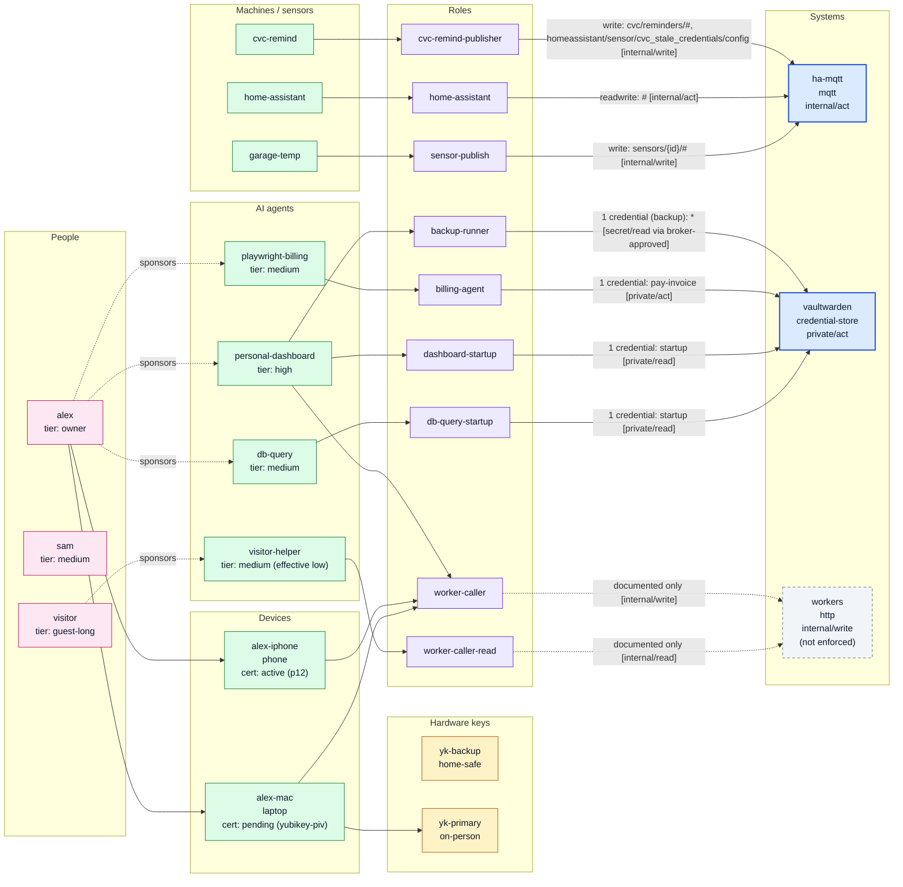

# Access graph

Generated 2026-10-31 by `cvc-access build graph` from the access registry.

Solid blue = enforced; dashed = documented only (not enforced); grey = expired; data/action labels (D16) are shown on systems and in brackets on grant edges; dotted 'sponsors' edges link a person to the agents they sponsor; orange = expires within 30 days; yellow dashed = unused role. Revoked certs and lost/revoked/retired hardware keys are grey. Cert serials and fingerprints are never shown.

## Principals

| id | type | tier | sponsor | roles | expires | status |
|---|---|---|---|---|---|---|
| db-query | agent | medium | alex | db-query-startup | - | active |
| personal-dashboard | agent | high | alex | backup-runner, dashboard-startup, worker-caller | 2027-01-31 | active |
| playwright-billing | agent | medium | alex | billing-agent | - | active |
| visitor-helper | agent | medium (effective low) | visitor | worker-caller-read | 2026-12-31 | active |
| cvc-remind | machine | - | - | cvc-remind-publisher | - | active |
| garage-temp | machine | - | - | sensor-publish | - | active |
| home-assistant | machine | - | - | home-assistant | - | active |
| alex-iphone | device | - | - | worker-caller | - | active |
| alex-mac | device | - | - | worker-caller | - | active |

## People

| id | tier | tailnet | ha | expires | granted by |
|---|---|---|---|---|---|
| alex | owner | owner | none | - | - |
| sam | medium | family | none | - | alex |
| visitor | guest-long | guests | none | 2026-12-31 | alex |

## Devices

| id | owner | kind | cert storage | cert status | cert not after | history entries |
|---|---|---|---|---|---|---|
| alex-iphone | alex | phone | p12 | active | 2027-01-31 | 1 |
| alex-mac | alex | laptop | yubikey-piv | pending | - | 0 |

## Hardware keys

| id | owner | model | uses | location | status | device certs |
|---|---|---|---|---|---|---|
| yk-backup | alex | YubiKey 5 NFC | fido2-vaultwarden, recovery | home-safe | active | 0 |
| yk-primary | alex | YubiKey 5C NFC | fido2-vaultwarden, piv-device-cert, recovery | on-person | active | 1 |

## Resources

| id | name | host | kind | min tier | ha level | passkey |
|---|---|---|---|---|---|---|
| books | Calibre library | books.example.home | library | guest-long | - | no |
| dashboard | Personal dashboard | dash.example.home | dashboard | high | - | yes |
| ha | Home Assistant | ha.example.home | ha | medium | limited-control | no |
| media | Jellyfin | media.example.home | media | media-only | - | no |
| portainer | Portainer | portainer.example.home | admin | admin | - | yes |

## What each person can reach

Same rule as the tier gate: active person, tier >= resource min tier. `yes*` = passkey (Authentik) also required.

| person | tier | books | dashboard | ha | media | portainer |
|---|---|---|---|---|---|---|
| alex | owner | yes | yes* | yes | yes | yes* |
| sam | medium | yes | - | yes | yes | - |
| visitor | guest-long | yes | - | - | - | - |

## Systems

| id | kind | data | action | enforced |
|---|---|---|---|---|
| ha-mqtt | mqtt | internal | act | yes |
| vaultwarden | credential-store | private | act | yes |
| workers | http | internal | write | no |
